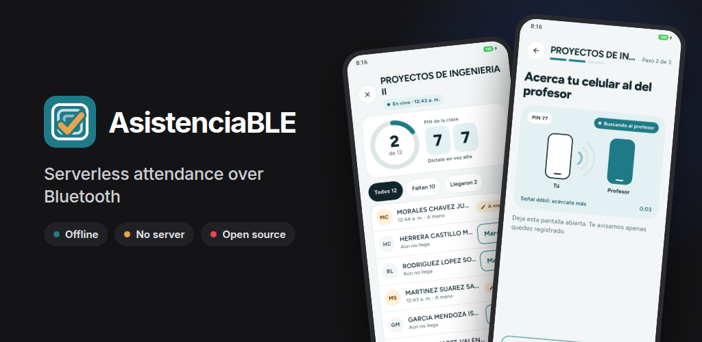
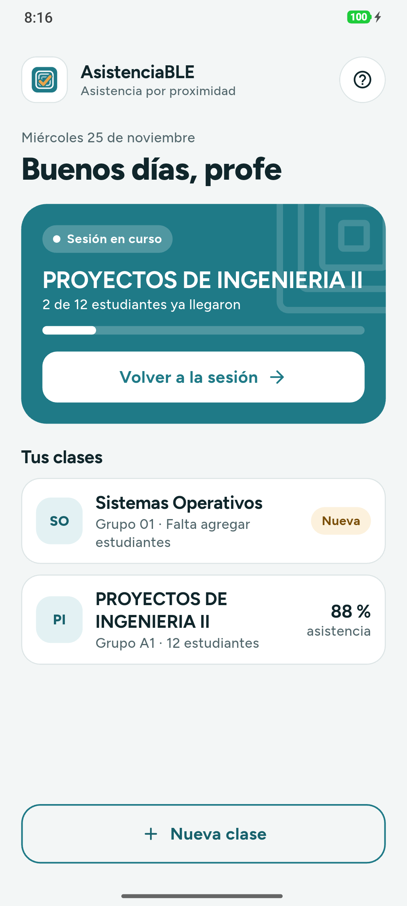
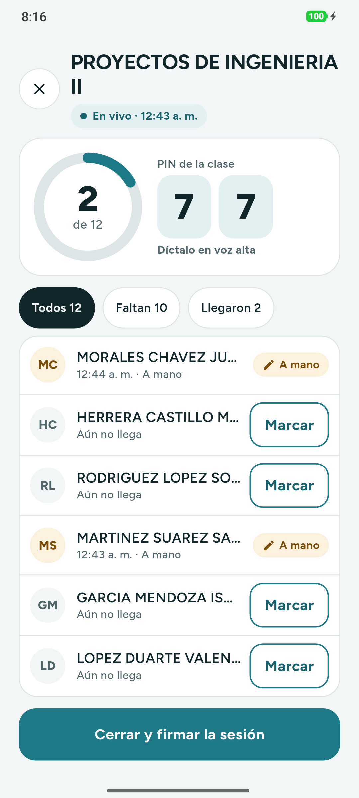
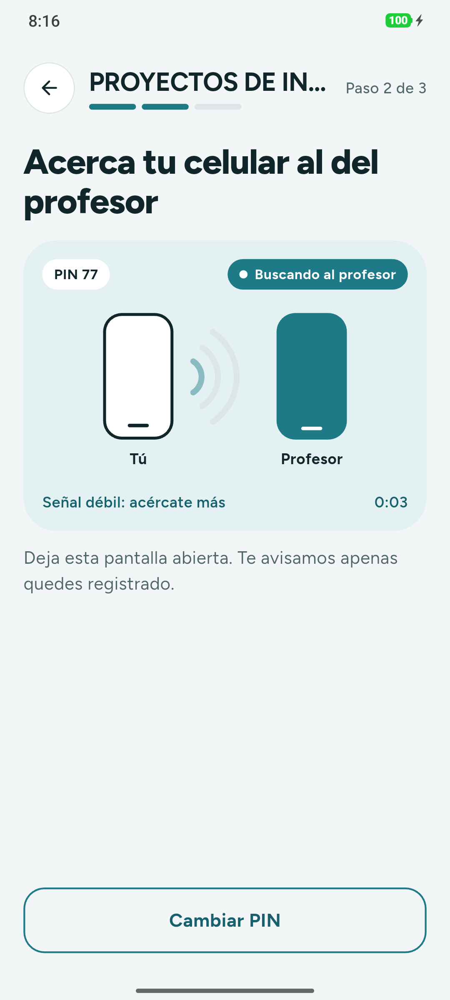
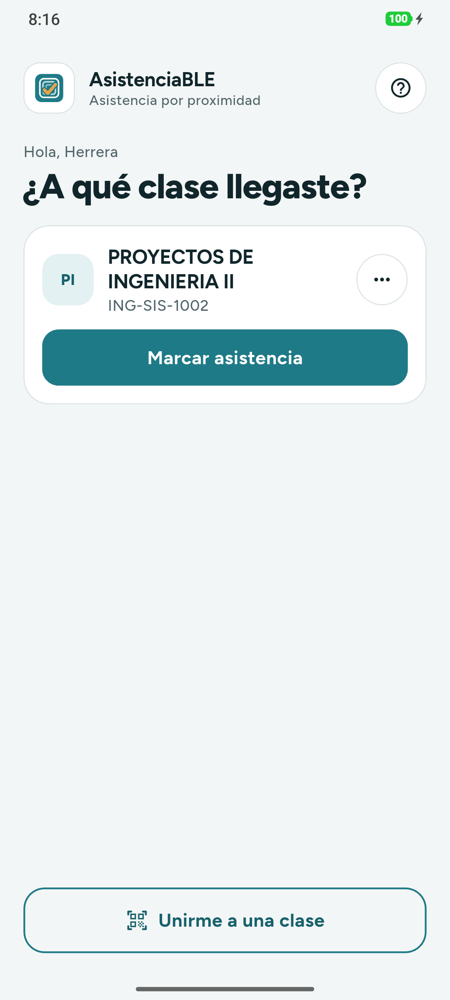
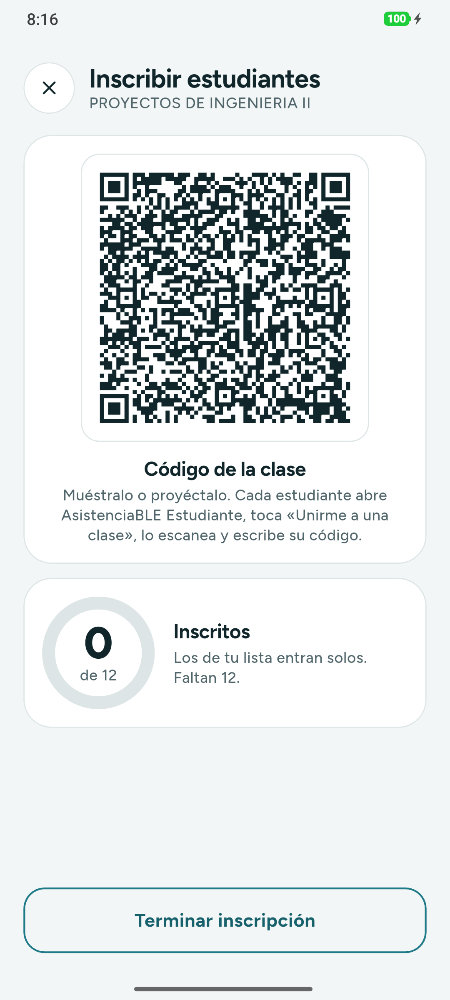
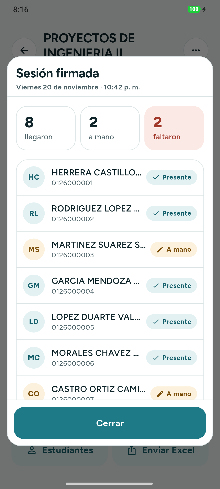
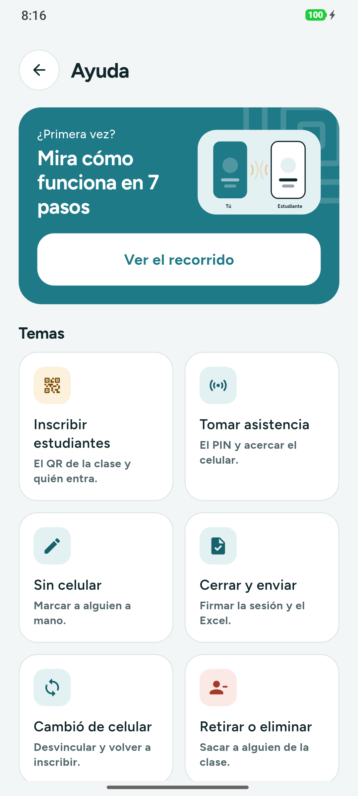
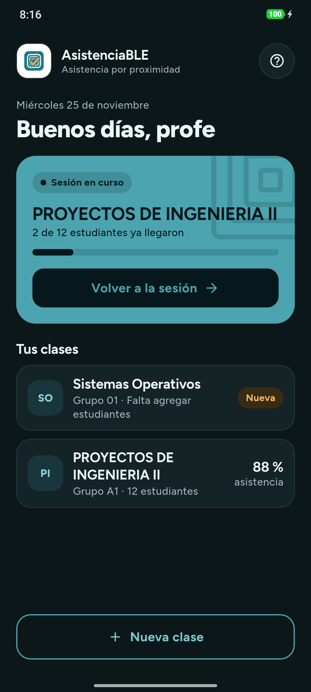

<p align="center">
  
</p>

<h2 align="center">AsistenciaBLE</h2>

<h4 align="center">Asistencia sin servidor y sin internet para instituciones de educación superior: el estudiante marca acercando su celular al del docente, por Bluetooth de baja energía.</h4>

<p align="center">
  <a href="https://github.com/y0ner/asistencia-ble/releases/latest/download/asistenciable-docente-v1.0.0-arm64.apk">
    
  </a>
  <a href="https://github.com/y0ner/asistencia-ble/releases/latest/download/asistenciable-estudiante-v1.0.0-arm64.apk">
    
  </a>
</p>

<p align="center">
  <a href="https://github.com/y0ner/asistencia-ble/releases/latest"></a>
  <a href="LICENSE"></a>
  <a href="https://developer.android.com"></a>
  <a href="https://flutter.dev"></a>
  <a href="#privacidad"></a>
  <a href="#c%C3%B3mo-funciona"></a>
  <a href="#privacidad"></a>
</p>

<p align="center">
  <a href="README.md">English</a> &bull; Español
</p>

<p align="center">
  <a href="#capturas-de-pantalla">Capturas</a> &bull;
  <a href="#descripción">Descripción</a> &bull;
  <a href="#cómo-funciona">Cómo funciona</a> &bull;
  <a href="#características">Características</a> &bull;
  <a href="#descarga-e-instalación">Descarga e instalación</a> &bull;
  <a href="#privacidad">Privacidad</a> &bull;
  <a href="#compilación-desde-el-código-fuente">Compilación</a> &bull;
  <a href="#pila-tecnológica-y-arquitectura">Pila tecnológica</a> &bull;
  <a href="#proyecto-académico">Proyecto académico</a> &bull;
  <a href="#cómo-se-construyó">Cómo se construyó</a> &bull;
  <a href="#contribución">Contribución</a> &bull;
  <a href="#licencias-de-terceros">Terceros</a> &bull;
  <a href="#licencia">Licencia</a>
</p>

<p align="center">
  <a href="https://asistencia-ble.vercel.app">Sitio web</a> &bull;
  <a href="https://github.com/y0ner/asistencia-ble/releases">Lanzamientos</a> &bull;
  <a href="CHANGELOG.md">Registro de cambios</a>
</p>

---

Versión actual: **1.0.0** — [notas de lanzamiento](CHANGELOG.md)

---

## Capturas de pantalla

<p align="center">
  
</p>

| 1. Inicio del docente | 2. Sesión en vivo del docente | 3. Estudiante marcando | 4. Confirmación ¡Presente! |
| :---: | :---: | :---: | :---: |
|  |  |  |  |

| 5. Inscripción por QR | 6. Cierre y reporte Excel | 7. Centro de ayuda | 8. Inicio del docente (modo oscuro) |
| :---: | :---: | :---: | :---: |
|  |  |  |  |

---

## Descripción

**AsistenciaBLE** es un sistema de registro y control de asistencia por proximidad física diseñado específicamente para instituciones de educación superior. Permite a los docentes tomar asistencia en segundos mediante **Bluetooth Low Energy (BLE)** entre teléfonos móviles, sin necesidad de conexión a internet en el salón, sin servidores externos y con costo de infraestructura cero.

El control de asistencia tradicional suele oscilar entre listas de papel propensas a errores o sistemas en la nube que fallan ante la inestabilidad de la red inalámbrica del campus. AsistenciaBLE resuelve ambos problemas operando bajo un modelo **serverless y offline-first**:
- No requiere configurar, pagar ni mantener servidores.
- Cero consumo de datos móviles o internet durante la clase.
- Etiquetas criptográficas rotativas y un alcance corto que dificultan mucho la suplantación y la asistencia a distancia.
- Dos sabores especializados (**Docente** y **Estudiante**) generados desde una única base de código Flutter.

---

## Cómo funciona

El protocolo de asistencia no requiere emparejamiento Bluetooth, conexiones GATT activas ni acceso a internet:

### 1. Inscripción el primer día (Una vez por curso)

Antes de iniciar las clases regulares, los estudiantes matriculan su celular en la lista local del docente:

| Paso | Acción | Responsable | Mecanismo |
| :---: | :--- | :--- | :--- |
| **1** | Proyectar QR del curso | Docente | Muestra en pantalla el código QR con su clave pública y el identificador del curso |
| **2** | Escanear QR e ingresar código | Estudiante | Escanea el código con su cámara y digita su código estudiantil |
| **3** | Enviar solicitud por BLE | Estudiante | Emite un paquete BLE con su clave pública X25519 efímera |
| **4** | Aprobación de la solicitud | Docente | Verifica los datos del estudiante en pantalla y le asigna una casilla (0–63) |
| **5** | Derivación del secreto local | Ambos | Ambos dispositivos derivan un secreto local mediante HKDF-SHA256 |

### 2. Toma de asistencia en clase (Cada sesión)

Durante cada clase regular, el proceso de registro toma pocos segundos:

| Paso | Acción | Responsable | Detalle técnico |
| :---: | :--- | :--- | :--- |
| **1** | Iniciar sesión y dictar PIN | Docente | Abre la sesión en su app y dicta un PIN verbal de 2 dígitos |
| **2** | Digitar PIN y acercar celular | Estudiante | Escribe el PIN de 2 dígitos y acerca su celular al del docente |
| **3** | Emisión de baliza rotativa | Estudiante | Emite paquete BLE de 16 bytes con etiqueta rotativa HMAC-SHA256 (cambia cada 30 s) |
| **4** | Detección de proximidad y registro | Docente | El docente recibe el paquete si la señal supera el umbral RSSI (defecto: −75 dBm) y marca su bit en el mapa de bits |
| **5** | Emisión de eco de confirmación | Docente | Emite paquete BLE de eco cada 1 s con el mapa de bits de 8 bytes (64 posiciones) |
| **6** | Confirmación instantánea | Estudiante | Detecta su bit activo en el eco recibido y muestra de inmediato **«¡Presente!»** con sello verde |

### 3. Lista invertida y cierre de sesión

- **Lista invertida de excepción:** Si un estudiante no tiene celular o se quedó sin batería, el docente lo marca como presente a un solo toque en la pantalla de la sesión, asegurando cero exclusión.
- **Cierre y acta firmada:** Al finalizar, el docente cierra la sesión, generando un acta firmada criptográficamente y un archivo oficial de Excel (`.xlsx`) con 4 hojas: `Resumen`, `Detalle`, `Sesiones` y `Metadatos`.
- **Sincronización opcional:** El docente puede respaldar opcionalmente sus actas y hojas en Google Sheets y Google Drive con su cuenta de Google (o cuenta institucional en el perfil piloto).

---

## Características

- **Motor de proximidad BLE sin servidor:**
  - Paquetes de anuncio de 16 bytes compatibles con el estándar BLE Legacy (límite de 31 bytes).
  - Etiquetas criptográficas HMAC-SHA256 con ventana de rotación de 30 segundos contra ataques de retransmisión.
  - Eco docente con mapa de bits de 8 bytes para cursos de hasta 64 estudiantes.
  - Verificación de proximidad física mediante umbral de señal RSSI (−75 dBm por defecto; −95 dBm para enrolamiento).
- **Inscripción óptica el primer día:**
  - Escaneo local de código QR mediante la cámara.
  - Intercambio de claves en curva elíptica X25519.
  - Derivación HKDF-SHA256 que vincula el secreto del dispositivo al código del estudiante y al curso.
- **Gestión ágil de cursos y listas:**
  - Importación directa de listas desde libros Excel (`.xlsx`) y archivos de texto (`.csv`).
  - Pegado masivo desde el portapapeles y registro manual de estudiantes.
  - Independencia total de bases de datos o sistemas académicos centrales.
- **Lista invertida de excepción:**
  - Registro manual inmediato para estudiantes sin teléfono móvil o con batería agotada.
- **Reportes oficiales y exportación:**
  - Generación local de libros Excel (`.xlsx`) estructurados en 4 hojas: Resumen, Detalle, Sesiones y Metadatos.
  - Actas de sesión firmadas criptográficamente para auditoría.
  - Compartición nativa mediante la hoja del sistema operativo Android.
- **Respaldo opcional en la nube:**
  - Sincronización asíncrona con Google Sheets y Google Drive con la cuenta de Google del profesor.
- **Ayuda animada y recorridos interactivos:**
  - 13 escenas animadas en vectores que ilustran cada paso del flujo de trabajo.
  - Recorrido de inducción en la primera apertura y centro de ayuda temático contextual.
- **Diagnóstico y privacidad:**
  - Pantalla integrada de verificación interactiva de permisos de Bluetooth, Ubicación y Cámara.
  - Persistencia 100 % local en base de datos SQLite.

---

## Descarga e instalación

Descarga la versión correspondiente a tu rol desde [GitHub Releases](https://github.com/y0ner/asistencia-ble/releases/latest):

- **Para Profesores:** [Descargar App Docente (`asistenciable-docente-v1.0.0-arm64.apk`)](https://github.com/y0ner/asistencia-ble/releases/latest/download/asistenciable-docente-v1.0.0-arm64.apk)  
  *Application ID:* `co.edu.uniguajira.asistencia_uniguajira.docente`
- **Para Estudiantes:** [Descargar App Estudiante (`asistenciable-estudiante-v1.0.0-arm64.apk`)](https://github.com/y0ner/asistencia-ble/releases/latest/download/asistenciable-estudiante-v1.0.0-arm64.apk)  
  *Application ID:* `co.edu.uniguajira.asistencia_uniguajira.estudiante`

**Detalles del paquete:**
- **Tamaño de la APK:** ~{{APK_SIZE_MB}} MB
- **Sistema operativo mínimo:** Android 7.0 (API 24, Nougat) o superior
- **Requisito de hardware:** Celular con soporte para Bluetooth Low Energy (BLE) y modo periférico (BLE Advertising).

### Certificado de firma de APK

Las versiones oficiales están firmadas con nuestro almacén de claves de release. Puedes verificar la integridad del instalador con `apksigner`:

```text
11:4F:E7:08:BD:60:DF:3E:1B:7A:D9:C0:E8:CE:D5:0E:2A:42:84:EE:C4:25:49:A7:26:6B:97:C3:AA:54:DE:5E
```

---

## Privacidad

AsistenciaBLE ha sido diseñada siguiendo principios estrictos de privacidad y minimización de datos:

- **Sin servidor ni telemetría:** La aplicación no cuenta con servidores centrales, no contiene bibliotecas de analítica comercial ni efectúa rastreo en segundo plano.
- **Almacenamiento local:** Todos los listados, registros de asistencia y credenciales se almacenan exclusivamente en la base de datos local SQLite del celular.
- **Bluetooth Low Energy:** El Bluetooth se utiliza única y exclusivamente para medir la proximidad física en el aula. Los dispositivos no se emparejan permanentemente.
- **Transparencia en permisos:**
  - `BLUETOOTH_SCAN` (con bandera `neverForLocation`): Detecta los anuncios de asistencia en el salón sin acceder a la ubicación del usuario.
  - `BLUETOOTH_ADVERTISE`: Emite la baliza del estudiante o el eco de mapa de bits del docente.
  - `BLUETOOTH_CONNECT`: Permite la interacción con el adaptador Bluetooth en Android 12+.
  - `BLUETOOTH` y `BLUETOOTH_ADMIN`: Operaciones de compatibilidad en Android 11 o inferior (`maxSdkVersion 30`).
  - `ACCESS_FINE_LOCATION` y `ACCESS_COARSE_LOCATION`: Requerido exclusivamente en Android 11 o inferior (`maxSdkVersion 30`) por exigencia del sistema operativo para escaneo BLE. La aplicación no activa GPS ni recopila coordenadas geográficas.
  - `CAMERA`: Usado únicamente para el escaneo óptico del código QR de inscripción al curso.
  - `INTERNET`: Empleado exclusivamente si el docente decide activar la sincronización voluntaria con Google Sheets y Google Drive.
- **Datos personales:** Diseñada teniendo en cuenta la Ley Estatutaria 1581 de 2012 de Colombia.

---

## Compilación desde el código fuente

### Requisitos previos
- Flutter SDK 3.47.1 o compatible (Dart 3.13+)
- Android SDK con herramientas de plataforma (minSdk 24)
- JDK 17 (o el JBR incluido con Android Studio)

### Comandos de ejecución y compilación (`run.sh`)

```bash
# Ejecutar sabor Docente en dispositivo conectado o escritorio Linux
./run.sh docente android

# Ejecutar sabor Estudiante en dispositivo conectado o escritorio Linux
./run.sh estudiante android

# Compilar APK Release del Docente
./run.sh apk-docente

# Compilar APK Release del Estudiante
./run.sh apk-estudiante

# Compilar APKs Release de ambos sabores
./run.sh build-apk    # o también: ./run.sh apk

# Ejecutar análisis estático con linter
./run.sh analyze

# Ejecutar pruebas unitarias y de integración
./run.sh test
```

### Perfiles de compilación

- **Perfil general (predeterminado):** Marca neutra para cualquier institución de educación superior.
- **Perfil piloto:** Compila con el escudo institucional y exige el dominio `@uniguajira.edu.co` para la prueba piloto:
  ```bash
  INSTITUCION=uniguajira ./run.sh apk
  ```

---

## Pila tecnológica y arquitectura

- **Framework y lenguaje:** Flutter 3.47.1 / Dart 3.13
- **Base de datos local:** SQLite mediante `sqflite` (esquema v4)
- **Criptografía:**
  - `crypto` (etiquetas rotativas HMAC-SHA256)
  - `cryptography` (intercambio de claves X25519 y derivación HKDF-SHA256)
- **Bluetooth Low Energy:**
  - `flutter_blue_plus` (escaneo y recepción de balizas BLE)
  - `flutter_ble_peripheral` (emisión de balizas y paquetes de eco)
- **Escaneo óptico:** `mobile_scanner` (lectura de QR) y `qr_flutter` (generación de QR)
- **Reportes y hojas de cálculo:** `excel` (construcción de .xlsx) y `share_plus` (hoja de compartir del sistema)
- **Respaldo en la nube (opcional):** `google_sign_in`, `googleapis`, `http`
- **Diseño de interfaz:** Sistema de diseño propio (`lib/ui`) basado en tokens y componentes, tipografía Figtree (SIL Open Font License 1.1).

---

## Proyecto académico

Esta aplicación fue desarrollada como trabajo de grado titulado:

> **«Aplicación móvil para el registro de asistencia por proximidad Bluetooth sin servidor en instituciones de educación superior»**

- **Autores:** Yoner De Jesús Isaza Vides y Álvaro Luis Garrido Medina
- **Director:** Miguel Humberto Romero Acuña
- **Docente de Proyecto I:** Lisseth Paola Castañeda Vega
- **Programa Académico:** Ingeniería de Sistemas
- **Facultad:** Facultad de Ingeniería
- **Institución:** Universidad de La Guajira, Riohacha, 2026

*Nota:* La solución está diseñada para cualquier institución de educación superior (IES); la prueba piloto se realiza en el programa de Ingeniería de Sistemas de la Universidad de La Guajira, sede Riohacha. No constituye una aplicación oficial de la universidad.

---

## Cómo se construyó

AsistenciaBLE fue construida mediante un flujo de ingeniería de software multi-agente:

- **Agente jefe (Claude Code):** Redactó los briefs de tareas, gestionó los *worktrees* y ramas de Git, ejecutó las suites de análisis estático y pruebas automatizadas, realizó revisiones de código y aprobó las fusiones hacia la rama `dev`.
- **Agentes de Gemini (CLI `agy`):** Implementaron funcionalidades aisladas por tarea en ramas y *worktrees* dedicados, respetando contratos de interfaz estrictos.
- **Control de calidad en hardware:** Cada oleada de desarrollo fue validada y probada físicamente en **2 celulares Android reales** (`docs/agentes/`, `docs/pruebas/`) para corroborar el comportamiento de las antenas de radio en condiciones reales.

---

## Contribución

¡Las contribuciones son bienvenidas! Consulta nuestra [Guía de Contribución](CONTRIBUTING.md) para conocer las pautas sobre el modelo de ramas, estándares de código y políticas de modificación del protocolo BLE.

---

## Licencias de terceros

- **Tipografía Figtree:** Licenciada bajo la SIL Open Font License 1.1 (`assets/fonts/OFL.txt`).
- Las dependencias de código abierto de terceros se encuentran detalladas bajo sus respectivas licencias en `pubspec.yaml`.

---

## Licencia

Este proyecto está licenciado bajo la **Licencia Apache 2.0** — consulta el archivo [LICENSE](LICENSE) para más información.
