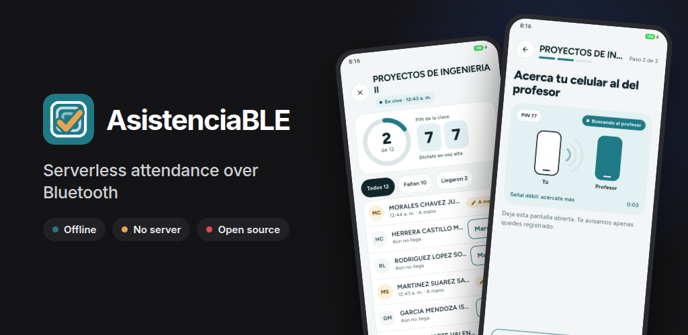
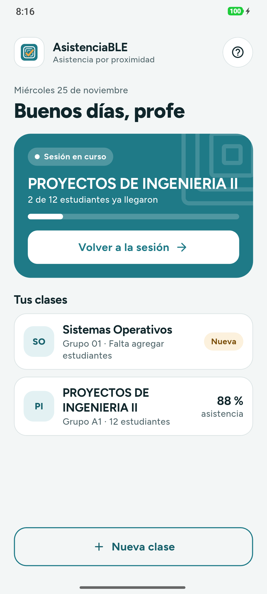
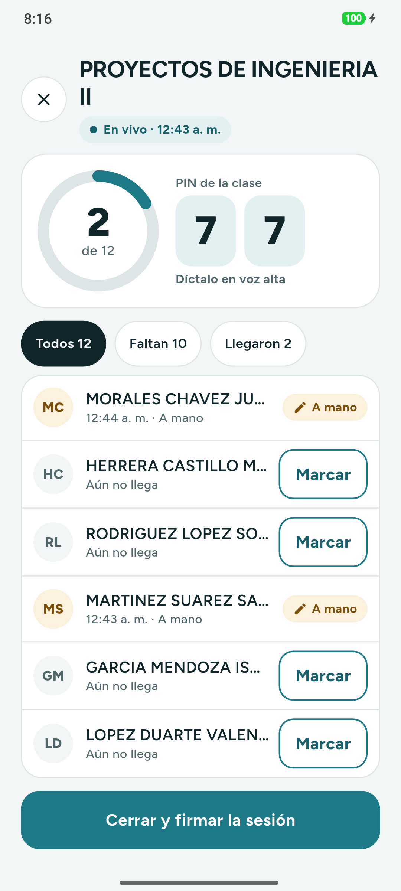
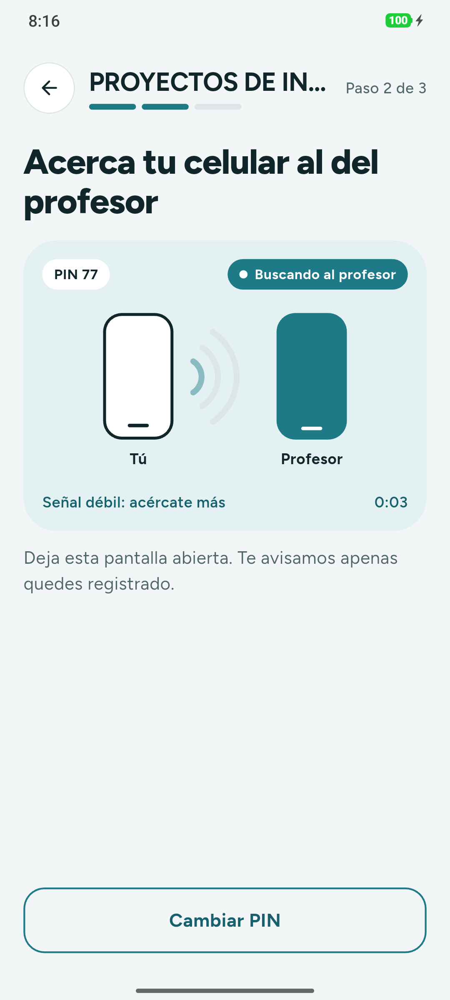
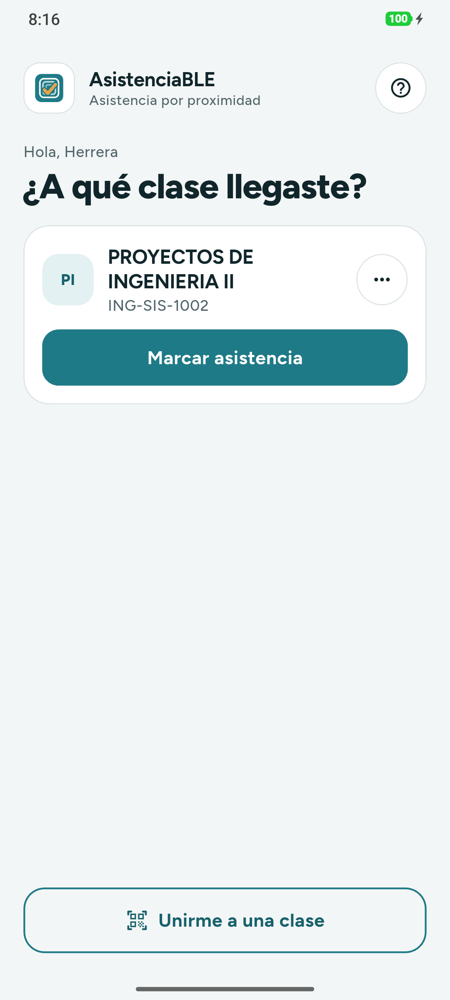
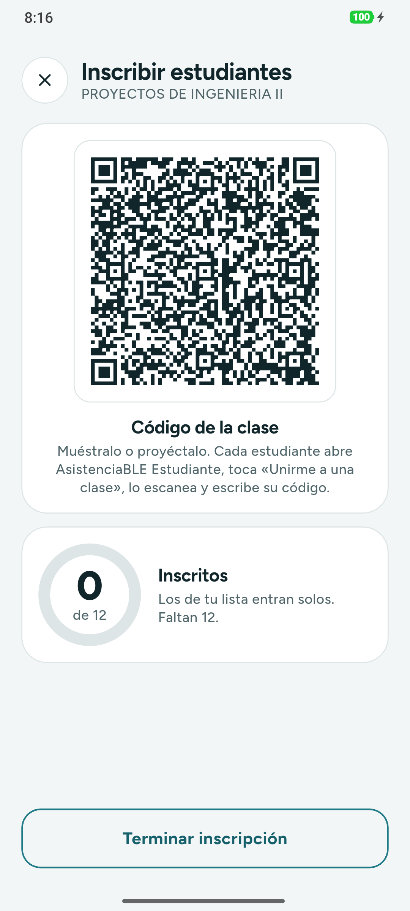
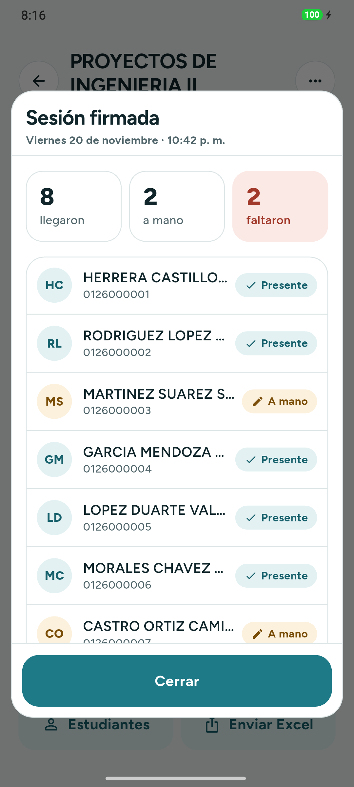
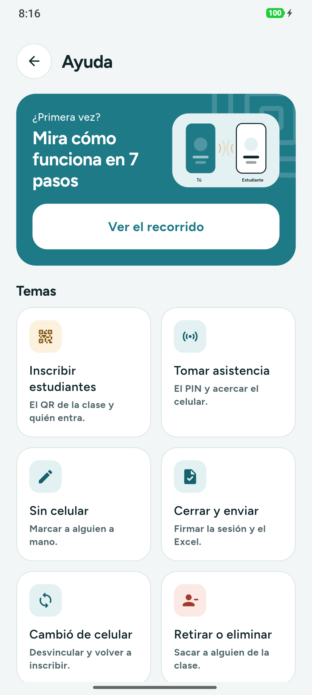
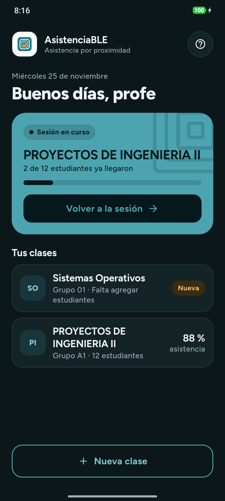

<p align="center">
  
</p>

<h2 align="center">AsistenciaBLE</h2>

<h4 align="center">Serverless, offline attendance for universities: students mark attendance by bringing their phone close to the teacher's, over Bluetooth Low Energy.</h4>

<p align="center">
  <a href="https://github.com/y0ner/asistencia-ble/releases/latest/download/asistenciable-docente-v1.0.0-arm64.apk">
    
  </a>
  <a href="https://github.com/y0ner/asistencia-ble/releases/latest/download/asistenciable-estudiante-v1.0.0-arm64.apk">
    
  </a>
</p>

<p align="center">
  <a href="https://github.com/y0ner/asistencia-ble/releases/latest"></a>
  <a href="LICENSE"></a>
  <a href="https://developer.android.com"></a>
  <a href="https://flutter.dev"></a>
  <a href="#privacy"></a>
  <a href="#how-it-works"></a>
  <a href="#privacy"></a>
</p>

<p align="center">
  English &bull; <a href="README.es.md">Español</a>
</p>

<p align="center">
  <a href="#screenshots">Screenshots</a> &bull;
  <a href="#description">Description</a> &bull;
  <a href="#how-it-works">How it works</a> &bull;
  <a href="#features">Features</a> &bull;
  <a href="#download--installation">Download & installation</a> &bull;
  <a href="#privacy">Privacy</a> &bull;
  <a href="#building-from-source">Building from source</a> &bull;
  <a href="#tech-stack--architecture">Tech stack & architecture</a> &bull;
  <a href="#academic-project">Academic project</a> &bull;
  <a href="#how-it-was-built">How it was built</a> &bull;
  <a href="#contributing">Contributing</a> &bull;
  <a href="#third-party">Third-party</a> &bull;
  <a href="#license">License</a>
</p>

<p align="center">
  <a href="https://asistencia-ble.vercel.app">Website</a> &bull;
  <a href="https://github.com/y0ner/asistencia-ble/releases">Releases</a> &bull;
  <a href="CHANGELOG.md">Changelog</a>
</p>

---

Current version: **1.0.0** — [release notes](CHANGELOG.md)

---

## Screenshots

<p align="center">
  
</p>

| 1. Teacher Home | 2. Teacher Live Session | 3. Student: Bring Phone Close | 4. Student Home |
| :---: | :---: | :---: | :---: |
|  |  |  |  |

| 5. QR Enrollment | 6. Signed Session | 7. Help Center | 8. Teacher Dark Mode |
| :---: | :---: | :---: | :---: |
|  |  |  |  |

---

## Description

**AsistenciaBLE** is a robust, offline-first attendance tracking system created for higher education institutions. It allows instructors to take classroom roll-call in seconds by leveraging physical device proximity over **Bluetooth Low Energy (BLE)**.

Traditional university attendance tracking suffers from either slow, paper-based roll calls or fragile cloud solutions that collapse when campus Wi-Fi falters. AsistenciaBLE solves both problems by operating completely **serverless and offline**:
- No central servers to maintain, pay for, or secure.
- Zero internet dependency during lecture hours.
- Rotating cryptographic tags and a short proximity range make proxy check-ins and remote attendance much harder.
- Two distinct roles (**Teacher** and **Student**) built from a unified Flutter codebase.

---

## How it works

The attendance process requires no Bluetooth pairing, no GATT server connections, and zero network access:

### 1. First-Day Enrollment (Once per course)

Before classes begin, students enroll their smartphone into the instructor's local class registry:

| Step | Action | Actor | Mechanism |
| :---: | :--- | :--- | :--- |
| **1** | Present course QR code | Teacher | Displays course public key and course ID on screen |
| **2** | Scan QR code & enter student ID | Student | Uses device camera locally to read public key and ID |
| **3** | Send enrollment request | Student | Transmits request over BLE containing X25519 public key |
| **4** | Review and approve | Teacher | Verifies student name and confirms enrollment slot (0–63) |
| **5** | Derive device secret | Both | Devices compute shared secret via HKDF-SHA256 locally |

### 2. Regular Class Attendance (Every session)

During routine classes, marking attendance takes only a few seconds:

| Step | Action | Actor | Details |
| :---: | :--- | :--- | :--- |
| **1** | Start session & announce PIN | Teacher | Opens class session; announces a temporary 2-digit PIN |
| **2** | Enter PIN & approach teacher | Student | Inputs 2-digit PIN and brings phone close to teacher's device |
| **3** | Broadcast rotating beacon | Student | Emits 16-byte BLE packet with HMAC-SHA256 tag (rotates every 30 s) |
| **4** | Proximity detection & registration | Teacher | App receives beacon if signal meets RSSI threshold (default: −75 dBm) and sets bit in 8-byte bitmap |
| **5** | Broadcast echo | Teacher | Emits legacy BLE advertisement every 1 s containing 64-bit attendance bitmap |
| **6** | Instant confirmation | Student | Reads echo, detects assigned bit set, and immediately shows **«¡Presente!»** with green seal |

### 3. Inverted Exception List & Session Wrap-Up

- **Inverted exception list:** Students with a dead battery or without a smartphone are never excluded. The instructor can mark them present with a single tap directly on screen.
- **Session closure & signed minutes:** Ending the session generates a cryptographically signed session minute and an official 4-sheet Excel workbook (`.xlsx`) containing `Resumen`, `Detalle`, `Sesiones`, and `Metadatos`.
- **Optional cloud synchronization:** Teachers can optionally sync session records to Google Sheets and Google Drive using their personal Google account (or pilot institutional account).

---

## Features

- **Serverless BLE Proximity Engine:**
  - 16-byte advertising packets compatible with BLE Legacy standard (fits within 31-byte advertising limit).
  - Rotating HMAC-SHA256 cryptographic tags updated every 30 seconds to prevent replay attacks.
  - Teacher echo with 8-byte bitmap supporting up to 64 students per classroom.
  - Physical proximity verification using calibrated RSSI thresholds (−75 dBm default; −95 dBm for enrollment).
- **Day-One Optical Enrollment:**
  - Fast QR code camera scan for visual authenticity.
  - X25519 elliptic-curve Diffie-Hellman key exchange.
  - HKDF-SHA256 key derivation binding the device secret to the student code and course.
- **Course & Roster Management:**
  - Direct import from Excel (`.xlsx`) and CSV (`.csv`) spreadsheets.
  - Batch paste from clipboard or single-student manual entry.
  - Operates autonomously without requiring integration with campus academic databases.
- **Inverted Exception List:**
  - One-tap attendance check for students without smartphones or with depleted batteries.
- **Official Reporting & Export:**
  - Generates comprehensive Excel spreadsheets (`.xlsx`) formatted across 4 sheets: Resumen, Detalle, Sesiones, and Metadatos.
  - Cryptographically signed session minutes for auditability.
  - Native file sharing via Android system share sheet.
- **Optional Cloud Backup:**
  - Asynchronous backup to Google Sheets and Google Drive using the instructor's Google account.
- **Illustrated Help & Walkthroughs:**
  - 13 custom animated vector scenes explaining every step of the workflow.
  - First-run guided onboarding and comprehensive contextual help center.
- **Diagnostics & Privacy Controls:**
  - Built-in interactive hardware diagnostics for Bluetooth, Location, and Camera permissions.
  - 100% offline-first operation with local SQLite storage.

---

## Download & installation

Download the latest release for your role from [GitHub Releases](https://github.com/y0ner/asistencia-ble/releases/latest):

- **For Teachers:** [Download Teacher App (`asistenciable-docente-v1.0.0-arm64.apk`)](https://github.com/y0ner/asistencia-ble/releases/latest/download/asistenciable-docente-v1.0.0-arm64.apk)  
  *Application ID:* `co.edu.uniguajira.asistencia_uniguajira.docente`
- **For Students:** [Download Student App (`asistenciable-estudiante-v1.0.0-arm64.apk`)](https://github.com/y0ner/asistencia-ble/releases/latest/download/asistenciable-estudiante-v1.0.0-arm64.apk)  
  *Application ID:* `co.edu.uniguajira.asistencia_uniguajira.estudiante`

**Package details:**
- **APK size:** ~35 MB
- **Minimum OS:** Android 7.0 (API level 24, Nougat) or higher
- **Hardware requirement:** Device must support Bluetooth Low Energy (BLE) and BLE Peripheral mode (Advertising).

### APK signing certificate

Official release builds are signed with our dedicated release keystore. You can verify APK integrity using `apksigner`:

```text
11:4F:E7:08:BD:60:DF:3E:1B:7A:D9:C0:E8:CE:D5:0E:2A:42:84:EE:C4:25:49:A7:26:6B:97:C3:AA:54:DE:5E
```

---

## Privacy

AsistenciaBLE is built from the ground up around data minimization and user privacy:

- **Serverless & Zero Telemetry:** The app has no backend server, contains no analytics SDKs, and performs no background tracking.
- **Local Persistence:** All course rosters, attendance logs, and student keys reside exclusively in the phone's local SQLite database.
- **Bluetooth Low Energy:** BLE is utilized solely for short-range in-room radio proximity detection. Devices do not establish persistent paired connections.
- **Permission Transparency:**
  - `BLUETOOTH_SCAN` (with `neverForLocation`): Detects in-classroom attendance beacons without deriving user location.
  - `BLUETOOTH_ADVERTISE`: Emits the student attendance beacon or the teacher bitmap echo.
  - `BLUETOOTH_CONNECT`: Interacts with the local Bluetooth adapter on Android 12+.
  - `BLUETOOTH` & `BLUETOOTH_ADMIN`: Legacy BLE communication for Android 11 and lower (`maxSdkVersion 30`).
  - `ACCESS_FINE_LOCATION` & `ACCESS_COARSE_LOCATION`: Required strictly on Android 11 and lower (`maxSdkVersion 30`) by OS security policy to scan BLE devices. No GPS hardware or geographical location is ever queried or collected.
  - `CAMERA`: Used exclusively for real-time optical scanning of the classroom enrollment QR code.
  - `INTERNET`: Required solely if the teacher chooses to enable optional Google Sheets and Google Drive synchronization.
- **Personal data:** Designed with Colombia's Statutory Law 1581 of 2012 on personal data protection in mind.

---

## Building from source

### Prerequisites
- Flutter SDK 3.47.1 or compatible (Dart 3.13+)
- Android SDK with platform tools (minSdk 24)
- JDK 17 (or the JBR bundled with Android Studio)

### Development commands (`run.sh`)

```bash
# Run Teacher flavor on connected device or Linux desktop
./run.sh docente android

# Run Student flavor on connected device or Linux desktop
./run.sh estudiante android

# Build Release APK for Teacher
./run.sh apk-docente

# Build Release APK for Student
./run.sh apk-estudiante

# Build Release APKs for both flavors
./run.sh build-apk    # or: ./run.sh apk

# Run static analysis
./run.sh analyze

# Run unit and integration tests
./run.sh test
```

### Build profiles

- **General Profile (Default):** Neutral branding suitable for any higher education institution.
- **Pilot Profile:** Compiles with the institutional crest and restricts cloud sync to the `@uniguajira.edu.co` domain for the pilot test:
  ```bash
  INSTITUCION=uniguajira ./run.sh apk
  ```

---

## Tech stack & architecture

- **Framework & Language:** Flutter 3.47.1 / Dart 3.13
- **Local Storage:** SQLite via `sqflite` (schema v4)
- **Cryptography:**
  - `crypto` (HMAC-SHA256 rotating tokens)
  - `cryptography` (X25519 key exchange, HKDF-SHA256 key derivation)
- **Bluetooth Low Energy:**
  - `flutter_blue_plus` (BLE scanning and reception)
  - `flutter_ble_peripheral` (BLE advertising and echo transmission)
- **Optical Scanning:** `mobile_scanner` (QR scanning) & `qr_flutter` (QR generation)
- **Reporting & Office:** `excel` (.xlsx generation) & `share_plus` (system share sheet)
- **Cloud Backup (Optional):** `google_sign_in`, `googleapis`, `http`
- **UI & System Design:** Custom design system (`lib/ui`) based on tokens and components, styled with Figtree typography (SIL Open Font License 1.1).

---

## Academic project

This software was developed as an undergraduate degree project titled:

> **«Aplicación móvil para el registro de asistencia por proximidad Bluetooth sin servidor en instituciones de educación superior»**

- **Authors:** Yoner De Jesús Isaza Vides & Álvaro Luis Garrido Medina
- **Director:** Miguel Humberto Romero Acuña
- **Course Professor (Proyecto I):** Lisseth Paola Castañeda Vega
- **Academic Program:** Ingeniería de Sistemas
- **Faculty:** Facultad de Ingeniería
- **Institution:** Universidad de La Guajira, Riohacha, 2026

*Note:* While the pilot study was conducted within the Systems Engineering program at the Universidad de La Guajira (Riohacha campus), AsistenciaBLE is designed as an open and adaptable solution for any higher education institution. It is not an official application of the university.

---

## How it was built

AsistenciaBLE was developed through an autonomous multi-agent software engineering workflow:

- **Lead Agent (Claude Code):** Acted as technical coordinator, authoring task briefs, creating isolated Git worktrees and feature branches, running static analysis and automated test suites, reviewing code, and merging pull requests into `dev`.
- **Worker Agents (Gemini via `agy` CLI):** Implemented targeted features per branch in strictly isolated worktrees, adhering to exact interface contracts.
- **Hardware QA:** Every release wave was physically validated on **2 real Android phones** (`docs/agentes/`, `docs/pruebas/`) to test real-world radio behaviors and timing.

---

## Contributing

We welcome contributions from the community! Please review our [Contributing Guide](CONTRIBUTING.md) for details on our branching strategy, coding standards, and BLE protocol governance.

---

## Third-party

- **Figtree Font:** Licensed under the SIL Open Font License 1.1 (`assets/fonts/OFL.txt`).
- Third-party open-source libraries are credited in their respective licenses under `pubspec.yaml`.

---

## License

This project is licensed under the **Apache License 2.0** — see the [LICENSE](LICENSE) file for details.

---

<div align="center">
  <i>Developed and maintained with high technical quality standards by <a href="https://github.com/y0ner">y0ner</a></i>
</div>
